<a href="https://aranish.uk">
  <picture>
    <source media="(prefers-color-scheme: dark)" srcset="./assets/hero-dark.svg">
    <source media="(prefers-color-scheme: light)" srcset="./assets/hero-light.svg">
    
  </picture>
</a>

<a href="https://aranish.uk/recruiters"><picture><source media="(prefers-color-scheme: dark)" srcset="./assets/btn-hire-dark.svg"></picture></a>
<a href="https://aranish.uk"><picture><source media="(prefers-color-scheme: dark)" srcset="./assets/btn-site-dark.svg"></picture></a>
<a href="https://www.linkedin.com/in/abhinavranish/"><picture><source media="(prefers-color-scheme: dark)" srcset="./assets/btn-linkedin-dark.svg"></picture></a>
<a href="mailto:chatgpt@asu.edu"><picture><source media="(prefers-color-scheme: dark)" srcset="./assets/btn-email-dark.svg"></picture></a>
<a href="https://x.com/madebyabhinav"><picture><source media="(prefers-color-scheme: dark)" srcset="./assets/btn-x-dark.svg"></picture></a>
 
or email <a href="mailto:chatgpt@asu.edu">chatgpt@asu.edu</a>

### `abhinav@aranish ~ $ whoami`

CS @ ASU (the Harvard of the West, source: trust me), building from Phoenix. I founded **contentOS** and **[ada](https://tryada.app)**, built **[CVfy](https://cvfy.dev)** and **[Focus Spoofer](https://focus.oddworks.us)**; before that, PM @ TruckerPath, security @ Ampcus and IT/Azure @ QFCRA.

### `~ $ ls ./building`

<a href="https://cvfy.dev">
  <picture>
    <source media="(prefers-color-scheme: dark)" srcset="./assets/card-cvfy-dark.svg">
    <source media="(prefers-color-scheme: light)" srcset="./assets/card-cvfy-light.svg">
    
  </picture>
</a>

&nbsp;&nbsp;40+ themes · custom domains · see who opens it · free to publish (<a href="https://cvfy.dev">cvfy.dev</a>)

<a href="https://focus.oddworks.us">
  <picture>
    <source media="(prefers-color-scheme: dark)" srcset="./assets/card-focus-dark.svg">
    <source media="(prefers-color-scheme: light)" srcset="./assets/card-focus-light.svg">
    
  </picture>
</a>

&nbsp;&nbsp;visibility + focus spoofing · canvas/WebGL/audio fingerprint randomization · <a href="https://github.com/Abhinav-ranish/Focus-Spoofer">source on GitHub</a>

&nbsp;&nbsp;also building: <a href="https://tryada.app">ada</a>, the share button as an AI assistant · contentOS

### `~ $ ls ./shipped`

| project | what it does |
|---|---|
| [IntelliTab](https://github.com/Abhinav-ranish/IntelliTab) · [live](https://intellitab.aranish.uk) | AI Chrome extension that sorts tabs into native tab groups and learns from your corrections TypeScript · React · MV3 · multi-LLM |
| [WiSpec](https://github.com/Abhinav-ranish/WiSpec) · [live](https://wispec.aranish.uk) | Dual-band Wi-Fi spectroscopy that classifies materials with under $200 of hardware Python · Scapy · PicoScenes · ML |
| [ux-guardian](https://github.com/aranish-uk/ux-guardian) · [demo](https://ux-guardian-demo.vercel.app) | AI customer-journey regression tests on every PR Python · LLM agents |
| [swarm-persona](https://github.com/Abhinav-ranish/swarm-persona) | LLM persona agents QA your PR preview behind a network write guard Python · LLM agents |
| [ClawHub](https://github.com/aranish-uk/ClawHub) | Self-hosted GitHub for autonomous agents, with Git Smart HTTP Fastify · Prisma · Postgres |
| [ASU-ClassEnroller](https://github.com/Abhinav-ranish/ASU-ClassEnroller) | Auto-enrolls you in your ASU classes Python · Selenium · Node |

also: <a href="https://readflow.aranish.uk">Readflow</a> · <a href="https://stock.aranish.uk">AI-Stock-Analyzer</a> · <a href="https://github.com/Abhinav-ranish/blackbox-lunar">blackbox-lunar</a> · <a href="https://github.com/Abhinav-ranish/PII-Redactor">PII-Redactor</a>

### `~ $ airflow dags trigger abhinav_daily`

  <picture>
    <source media="(prefers-color-scheme: dark)" srcset="./assets/pipeline-dark.svg">
    <source media="(prefers-color-scheme: light)" srcset="./assets/pipeline-light.svg">
    
  </picture>

<b><code>~ $ which tools</code></b> (click to expand)

 

<picture>
  <source media="(prefers-color-scheme: dark)" srcset="./assets/stack-dark.svg">
  <source media="(prefers-color-scheme: light)" srcset="./assets/stack-light.svg">
  
</picture>

<b><code>~ $ tail -n 6 activity.log</code></b> (recently shipped)

 

<!--START_SECTION:activity-->
- <code>2026-10-25</code> pushed to [Abhinav-ranish/Abhinav-ranish](https://github.com/Abhinav-ranish/Abhinav-ranish)
- <code>2026-10-23</code> opened PR [Abhinav-ranish/Focus-Spoofer#15](https://github.com/Abhinav-ranish/Focus-Spoofer/pull/15)
- <code>2026-10-20</code> pushed to [Abhinav-ranish/swarm-persona](https://github.com/Abhinav-ranish/swarm-persona)
- <code>2026-10-14</code> opened PR [Abhinav-ranish/Focus-Spoofer#14](https://github.com/Abhinav-ranish/Focus-Spoofer/pull/14)
- <code>2026-10-14</code> opened PR [Abhinav-ranish/Focus-Spoofer#13](https://github.com/Abhinav-ranish/Focus-Spoofer/pull/13)
- <code>2026-10-11</code> opened PR [aranish-uk/ux-guardian#3](https://github.com/aranish-uk/ux-guardian/pull/3)
<!--END_SECTION:activity-->

### `~ $ exit`

<picture>
  <source media="(prefers-color-scheme: dark)" srcset="./assets/footer-dark.svg">
  <source media="(prefers-color-scheme: light)" srcset="./assets/footer-light.svg">
  
</picture>

  
   
  Every custom visual here is generated by <a href="./scripts/build_assets.py">scripts/build_assets.py</a> · the visit counter is self-hosted on aranish.uk

